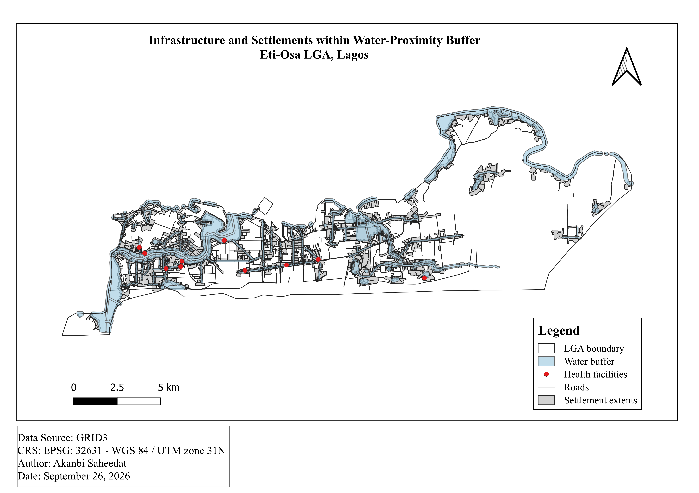

# Eti-Osa Flood Exposure Mapping

Maps flood hazard zones across Eti-Osa LGA, Lagos, and quantifies how many people, health facilities, and roads sit inside them, so planners can see where flood defenses and evacuation routes matter most.

**GeoDev Lab Africa, Cohort One.** Akanbi Saheedat

# Month 1: GIS Foundation and the Data Ecosystem

## The question

> How can flood risk zones in Eti-Osa LGA be mapped and quantified in terms of exposed population and critical infrastructure?

## What this answers so far

> Within the selected 50m waterway and 100m water-body proximity zones, 1,532 of 5,903 settlement extents, 2,563 of 11,940 road features, and 10 of 138 health facilities in Eti-Osa fall inside the water-proximity zone.

This is a proximity result, not the final flood-risk result, the hazard model still needs elevation, slope, and a documented weighting method before that stronger claim can be made.

## The four weeks

| Week | What it covers | Doc |
|---|---|---|
| 1 | The question, study area, and every dataset with a source link | [01-project-brief.md](docs/01-project-brief.md) |
| 2 | What was downloaded, its structure, and what's wrong with it | [02-data-notes.md](docs/02-data-notes.md) |
| 3 | Reprojection, clipping, and five quality checks | [03-data-preparation.md](docs/03-data-preparation.md) |
| 4 | Spatial operation and its result | [month-01-summary.md](docs/month-01-summary.md) |

Map: 

# Month 2: Development Environment and Early Python

## Week 5: The Terminal and VS Code

Set up Python, VS Code and the terminal. [hello.py](scripts/hello.py) runs.

## Week 6: Environment and Project Setup with uv

Set up the project with uv and added pandas.
[check.py](scripts/check.py) prints the pandas version.

## Week 7: Python, The Six Ideas 

[analyse.py](scripts/analyse.py) reads [wards.csv](wards.csv), converts each area and classifies each ward.

# What's in here

```
GeoDev_Lab_Project/
├── docs/
│   ├── 01-project-brief.md                          Week 1
│   ├── 02-data-notes.md                             Week 2
│   ├── 03-data-preparation.md                       Week 3
│   └── month-01-summary.md                          Week 4
├── data/
│   ├── raw/                                         downloads
│   └── processed/                                   outputs
├── analysis/  
│   └── water_buffer_analysis.gpkg                   Week 4 output
├── maps/                                
│   └── water_buffer_exposure.png                    exported map images
├── screenshots/
│   ├── week5.png                                    Week 5
│   ├── week6.png                                    Week 6
│   └── week7.png                                    Week 7
├── scripts/
│   ├── analyse.py                                   reads wards.csv
│   ├── check.py                                     imports and prints pandas version
│   └── hello.py                                     prints a message to check that Python runs
├── pyproject.toml                                   project metadata
├── uv.lock                                          records dependency versions for uv
├── wards.csv                                        example dataset
└── requirements.txt                                 required libaries
```

## How to run it

```bash
git clone https://github.com/holuwarkemmy/GeoDev_Lab_Project.git
cd GeoDev_Lab_Project

python -m venv .venv
source .venv/bin/activate        # Windows: .venv\Scripts\activate
pip install -r requirements.txt
```

## Progress

- [x] Week 1, project brief with a source link for every dataset
- [x] Week 2, data downloaded, opened and described
- [x] Week 3, reprojected, clipped and quality checked
- [x] Week 4, first spatial analysis, checked four ways
- [x] Week 5, the terminal and VS Code
- [x] Week 6, environment and project setup with uv
- [x] Week 7, python, the six ideas


Akanbi Saheedat · GeoDev Lab Africa
Learn. Build. Collaborate. Transform.
